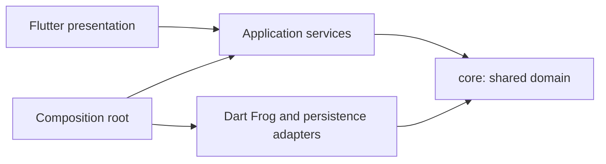

# Architecture Overview

Vaniawatch is a private watch collection for authenticated users. The domain
is a standalone Dart package in `core/`, shared by a future Dart Frog backend
and Flutter frontend. Only the domain is in scope today.

## Dependency Direction

The backend and frontend are planned consumers of `core`; neither is created
in this phase. The application and infrastructure labels describe future
responsibilities, not folders that should be added now.

## Current Slices

- `core/auth/`: user identity and email domain concepts. Credential handling
  is outside the domain.
- `core/catalog/`: watch entity, watch value objects, and owner-scoped
  repository port.
- `core/shared/`: stable domain primitives shared across slices.
- `backend/`: reserved for Dart Frog; currently empty.
- `frontend/`: reserved for Flutter; currently empty.

See [[rules]], [[domain-model]], and [[change-harness]].