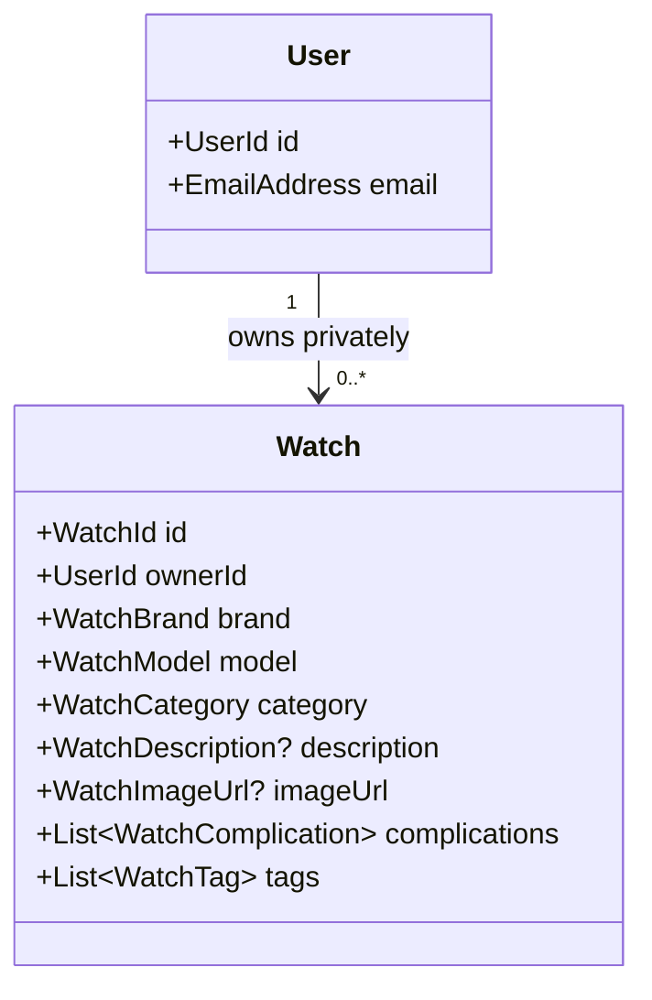

# Domain Model

## Auth

`User` represents an application user by `UserId` and `EmailAddress`. It does
not represent a password, credential, session, or authentication provider.
The authentication mechanism belongs outside `core/`. `User.empty()` provides
a transient neutral placeholder; it is not an authenticated user and must not
be persisted.

## Catalog

`Watch` is the collection item and carries its `WatchId`, `UserId` owner,
`WatchBrand`, `WatchModel`, and `WatchCategory`. Ownership and category are
required; description and image URL are optional. Complications and tags are
typed value-object lists, empty by default and immutable after creation.
`Watch.empty()` provides a transient placeholder with empty identity, owner,
brand, model, and category values. It is not an owned/persistable watch.

`WatchRepository` is a domain port. Its reads are owner-scoped by design:
`findByIdForOwner` requires both IDs, while `findAllForOwner` requires the
owner ID. Authorization enforcement in an eventual adapter remains
mandatory; a repository signature alone is not a security boundary.

## Deliberately Deferred

Movement, reference number, condition, purchase details, image storage,
sharing, and collection visibility are not modeled until requirements
establish their meaning and invariants. Image URLs are accepted as absolute
HTTP or HTTPS URLs; storage and retrieval belong outside the domain. A
collection is private by default; there is no public-sharing concept in the
current domain.