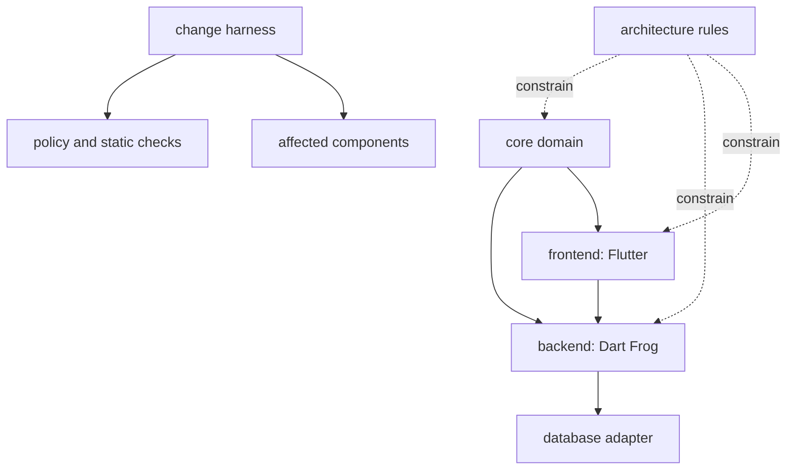

# Change Harness

The harness is a deterministic preflight for declared actions, not an
automatic interpreter of arbitrary natural-language requests. It checks
known prohibited intent and the current domain dependency/ownership
boundaries, then maps changed paths onto the project dependency graph.
Human review is still required for a `REVIEW` result and for policy changes.

## Before A Change

From the project root, declare the proposed action and planned paths:

```sh
dart tool/change_harness.dart \
  --action "Add a watch reference number" \
  --files core/catalog/entities/watch.entity.dart,core/catalog/value_objects
```

`ALLOW` means no configured rule matched. `REVIEW` means the intent or
affected paths are ambiguous. `PROHIBIT` means a project policy was matched;
do not proceed without changing the request/policy with explicit user
direction. The harness also scans Dart files in `core/` for outward framework
or persistence imports and verifies owner-scoped repository operations.

## Impact Graph



The CLI prints direct and downstream impact from the declared file paths.
Changing `core/` therefore flags both future application consumers.

## After A Feature Or Fix

The harness prints the decision, affected components, and boundary-check
results directly to the terminal. It does not write reports or action logs.
At completion, summarize the actual changes and validation results to the
user in the conversation.

## Obsidian MCP

`docs/` is ready to open as an Obsidian vault, using wikilinks, frontmatter,
and Mermaid. An Obsidian MCP server is not available in the current tool
environment, so no MCP endpoint or live vault connection is configured here.
When one is installed, point it at this `docs/` directory; keep Markdown as
the source of truth so ordinary Git tooling and Obsidian see the same pages.