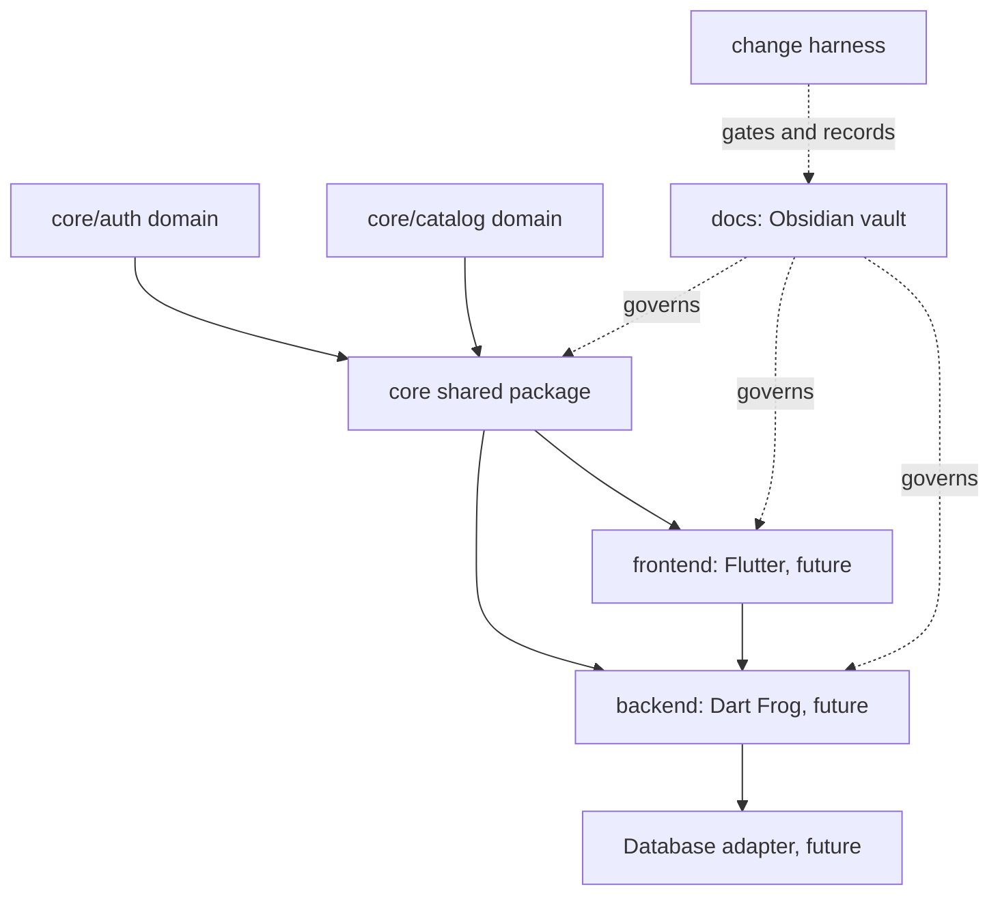

# Vaniawatch

This `docs/` directory is the project documentation vault. Open this folder
as an Obsidian vault; pages use Obsidian wikilinks and native Mermaid diagrams.

- [[architecture/README]]: project architecture and current scope.
- [[architecture/rules]]: enforceable boundaries and domain rules.
- [[architecture/domain-model]]: current domain concepts and ownership.
- [[change-harness]]: action gate, impact graph, and recording workflow.
- [[git-workflow]]: commit prompt and pre-push validation hooks.
- [[action-log/README]]: append-only feature/fix record index.

## Dependency Graph

`core` is shared domain code, not a backend or frontend subfolder. The two
application projects may depend on it; it must never depend on either one.